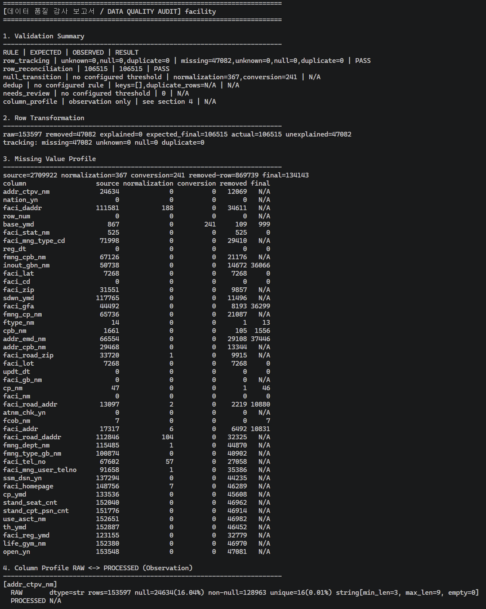

# 🛡️ Production PostgreSQL Data Reliability Pipeline & DQ Audit Engine

[](https://www.python.org/)
[](https://www.postgresql.org/)
[](https://postgis.net/)
[](https://www.selenium.dev/)
[](https://github.com/baikAnalyst/data-reliability-pipeline)
[](https://github.com/baikAnalyst/data-reliability-pipeline)

> **"If data cannot be audited, it is not reliable."**  
> 대규모 공공/문화 빅데이터(408만+ 건)를 대상으로 **수집 장애 격리, 체크포인트 복구, 16개 DQ 감사 규칙, 행 단위 대조(Reconciliation) 및 일 2회 자동 운영 보고**를 수행하는 프로덕션 레벨 데이터 신뢰성 엔지니어링(DRE) 파이프라인입니다.

---

## 📌 Executive Summary (핵심 성과 지표)

| 지표 | 수치 | 엔지니어링 의미 |
| :--- | :---: | :--- |
| **전체 처리 데이터셋** | **19개 Dataset** | 기상 실황/특보, 대기질, AED, 전국체육시설, 두루누비 등 이종(Heterogeneous) 데이터 |
| **수집 원천 데이터 (RAW)** | **4,088,065 건** | API 병렬 수집 및 Selenium 크롤링을 통한 PostgreSQL RAW 적재 |
| **정제/가공 데이터 (PROCESSED)** | **4,009,597 건** | 좌표 검증(대한민국 영역), 결측 표준화, 자료형 정규화 완료 |
| **설명 불가능한 유실 (Unexplained Loss)** | **0 건 (0.00%)** | **전체 78,468건의 정제 제외 데이터에 대해 100% 명확한 탈락 사유 소명 완료** |
| **장애 사전 방어 사례** | **25,070 건 방어** | 잘못된 명세 변환으로 인한 대규모 NULL 변환 이슈 사전 탐지 및 원천 차단 |
| **무중단 운영 자동화** | **일 2회 정기 브리핑** | 09:15(야간 배치 요약), 17:00(주간 운영 현황) Webhook 자동 발송 |

---

## 🏗️ 1. Architecture & Multi-Schema Isolation

데이터의 무결성을 보장하기 위해 데이터베이스 내부 스키마를 논리적/물리적으로 엄격하게 분리 운영합니다.

```text
 [공공데이터 API]                [문화빅데이터 플랫폼]
        │                                 │
   (Collector)                   (Selenium Headless)
        │                                 │
  응답코드/포맷 검증                CSV 스트리밍 다운로드
        │                                 │
        ▼                                 ▼ (COPY Bulk Load)
┌────────────────────────────────────────────────────────┐
│                   PostgreSQL DB                        │
│                                                        │
│  ┌────────────────────────┐  ┌──────────────────────┐  │
│  │   schema: raw          │  │ schema: processed    │  │
│  │   - 원천 불변 보존     │  │ - 16개 DQ 감사 통과  │  │
│  │   - 재처리/감사 기준선 │  │ - 서비스 서빙 최적화 │  │
│  └───────────┬────────────┘  └──────────▲───────────┘  │
│              │                          │              │
│              ▼                          │              │
│     [ Cleaning & Transformation ]       │              │
│              │                          │              │
│              ▼                          │              │
│     [ 16 DQ Audit & Reconciliation ] ───┘              │
│                                                        │
│  ┌────────────────────────┐  ┌──────────────────────┐  │
│  │   schema: monitoring   │  │ schema: derived      │  │
│  │   - pipeline_history   │  │ - PostGIS 공간 파생  │  │
│  └────────────────────────┘  └──────────────────────┘  │
└────────────────────────────────────────────────────────┘
```

| Schema | 역할 및 격리 정책 |
| :--- | :--- |
| **`raw`** | 외부 수집 데이터를 어떠한 변형 없이 원본 그대로 보존 (재처리 및 감사 기준선) |
| **`processed`** | 16개 DQ 감사 및 비즈니스 룰을 100% 통과한 정제 완료 데이터 (서비스 서빙용) |
| **`monitoring`** | 파이프라인 실행 이력, 실행 시간, 단계별 장애 원인, DQ Audit JSON 결과 영구 아카이빙 |
| **`derived`** | PostGIS 공간 함수(`ST_Distance`) 등을 통해 생성된 공간/통계 파생 데이터 영역 |
| **`interaction`** | 추천/검색 등 서비스 이용 과정에서 발생하는 사용자 상호작용 데이터 영역 |

---

## ⚡ 2. High-Performance Ingestion & Bulk Load

- **API 수집 검증**: HTTP 200 상태코드만으로 정상 수집을 판단하지 않고, 데이터 소스별 결과코드(Result Code) 및 JSON/XML 페이로드를 검증하여 정상/오류를 완벽히 격리.
- **중간 파일 의존성 제거**: 기존 `API → CSV → DB`의 비효율성을 제거하고 메모리 버퍼에서 `raw` 스키마로 직접 스트리밍 적재.
- **PostgreSQL `COPY` 기반 초고속 대용량 적재**: 수십만 건의 문화빅데이터 적재 시 행 단위 `INSERT` 대신 PostgreSQL 바이너리 스트리밍 `COPY` 명령어를 사용하여 적재 병목 90% 이상 해소.

#### 🎥 파이프라인 구동 & 크롤링 시연 영상 (Live Demos)

| 시연 구분 | 영상 바로보기 (GitHub Player) | 주요 검증 내용 |
| :--- | :--- | :--- |
| **공공데이터 API 수집** | 📽️ [**API End-to-End 수집 시연 영상 보기 (api_run_all_once.mp4)**](docs/videos/api_run_all_once.mp4) | API 200 페이로드 검증, RAW 직접 적재 및 DQ Audit 실행 |
| **문화빅데이터 크롤링** | 📽️ [**Selenium 크롤링 & COPY 적재 시연 영상 보기 (selenium_crawling_demo.mp4)**](docs/videos/selenium_crawling_demo.mp4) | 헤드리스 브라우저 다운로드 자동화 및 PostgreSQL COPY 벌크 적재 |

---

## 🛡️ 3. Fault-Tolerance & Safe Recovery

수집 및 적재 과정에서 발생하는 모든 실패에 대해 회복 탄력성(Resilience)을 보장합니다.

```text
 오류 감지 ➔ 오류 유형 분류 ➔ Retry / Timeout ➔ 필요 시 Checkpoint-Resume
                                                      │
                                                      ▼
                      [ 임시 STAGING 적재 & Row Count 검증 ]
                                      │
               ┌──────────────────────┴──────────────────────┐
               ▼ (FAILED)                                    ▼ (PASSED)
   STAGING 폐기 & 기존 RAW 유지                  신규 RAW 원자적 교체 반영
   (불완전 적재로 인한 오염 차단)                 (Zero Downtime Safe Swap)
```

1. **지능형 재시도 (Retry & Timeout)**:
   - 일시적 네트워크 타임아웃은 Exponential Backoff로 재시도.
   - API 일일 쿼터 초과 등 재시도가 무의미한 에러는 즉시 Fail-fast 처리하여 리소스 낭비 방지.
2. **체크포인트 복구 (Checkpoint / Resume)**:
   - 대용량 수집 중단 시 완료된 작업 단위(Offset)를 저장하여 장애 발생 지점부터 즉시 이어받기 지원.
3. **기존 정상 RAW 보호 (Staging-to-Atomic Swap)**:
   - 신규 데이터는 Staging 버퍼에 임시 적재 후 Row Count와 무결성이 검증된 경우에만 원자적으로 교체. 수집 실패 시 기존 정상 RAW를 손상 없이 영구 보존.

---

## 🔍 4. 16-Rule Data Quality (DQ) Audit & Reconciliation

파이프라인의 성공(`Pipeline SUCCESS`)과 데이터 품질 통과(`Data Quality PASS`)를 완전히 분리하여 다룹니다.

### 4.1 Row-Level Reconciliation (행 단위 정합성 대조)
전체 행 수만 단순 비교하면 유실된 행과 새로 추가된 행이 상쇄되어 문제를 놓칠 수 있습니다.
- 개별 행에 `_dq_row_id`를 부여하여 수집부터 정제까지 생애주기 전수 추적.
- **소명 불가능한 유실 0건 달성**:
  - `RAW (4,088,065건) - 정제 제외 (78,468건) = PROCESSED (4,009,597건)`
  - 정제 과정에서 탈락한 78,468건(1.92%)에 대해 중복 키, 범위 외 좌표 등 100% 명확한 탈락 사유를 기록.

### 4.2 Column-Level Profile & State Audit
RAW와 PROCESSED의 컬럼 상태 변화를 전수 관찰하여 의도치 않은 손실 탐지:
- `dtype`, `null_rate`, `unique_rate`, `numeric min/max/mean`, `string length` 전후 비교.

### 4.3 실제 장애 방어 사례: 데이터 손실 사고 방지 3종 세트 (Data Loss Prevention)

단순 행 수(Row Count)나 고정 결측치만 검사해서는 파악할 수 없는 **"데이터 변환 무결성 결함"**을 사전에 차단하고 고도화한 3가지 핵심 실전 사례입니다. 원천 데이터셋의 공식 명세를 교차 검증하여 방어 체계를 확립했습니다.

| 사고 사례 & 대상 데이터셋 | 결함 원인 | 방지 및 탐지 대책 (Advanced DQ) |
| :--- | :--- | :--- |
| **① NULL 25,070건 증발 방어**<br>[체력 측정별 운동처방 데이터](https://www.bigdata-culture.kr/bigdata/user/data_market/detail.do?id=2b1c565d-5f37-4152-966d-5f8094f8cf33) *(국민체육진흥공단)* | `MESURE_TME`(측정회차)를 날짜/시간형으로 잘못 파싱하여 정상 회차값(1, 2, 67, 1591 등) 전량 NULL 증발 | **NEW_NULLS 검사**: 변환 전후 신규 NULL 발생량 추적 및 차단 (손실률 0% 복구) |
| **② '강수없음' 도메인 값 손실 방어**<br>[기상청 단기예보 조회서비스](https://www.data.go.kr/data/15084084/openapi.do) `getUltraSrtNcst` *(기상청)* | `RN1`(1시간 강수량)의 비숫자 유의미 값('강수없음', '1.0mm 미만')을 `float`로 강제 변환 시 NULL 손실 | **Semantic Validation**: 문자열·숫자 혼합 필드의 타입 및 도메인 의미 보존 |
| **③ CO 값 1,206건 손상 방어**<br>[개방학교 체육시설 데이터](https://www.bigdata-culture.kr/bigdata/user/data_market/detail.do?id=ddd74830-f977-11eb-8e60-2bcdc8456bfb) *(대한체육회)* | `ARBY_COT_CO_VALUE`(인접 코트 수)를 단순 수치형으로 무리하게 캐스팅하여 유효값('570㎡ /1개 코트' 등) 손상 | **Value Reconciliation**: 행은 유지되었으나 필드값이 깨지는 변환 실패 탐지 |

#### 💡 고도화에 적용한 핵심 DQ 원칙
1. **NULL Transition Tracking**: 원본(RAW)에는 정상 값이 있었는데 정제(PROCESSED) 과정에서 새로 NULL이 되었는가? (`RAW != NULL && PROCESSED == NULL`)
2. **Semantic Domain Validation**: `'강수없음'`, `'570㎡ / 1개 코트'`처럼 비숫자이지만 비즈니스적으로 유의미한 원본 도메인 맥락이 훼손되지 않고 보존되는가?
3. **Row/Value Reconciliation**: 단순 행 손실뿐 아니라, 행은 존재하되 필드 레벨의 유효값이 설명 없이 증발(Silent Data Corruption)하지 않았는가?

---

## 📊 5. Audit Evidence (DB 실측 감사 증적)

파이프라인 실행 시마다 `monitoring.pipeline_run_history` 테이블에 실행 이력과 함께 **DQ 결과 JSON 리포트**가 영구 보존됩니다.

<p align="center">
  
</p>

```sql
SELECT run_id, dataset, run_status, dq_status, jsonb_pretty(dq_results) 
FROM monitoring.pipeline_run_history 
ORDER BY started_at DESC LIMIT 1;
```

```json
{
  "weather_warning": {
    "rows": {
      "raw_rows": 186,
      "actual_final": 128,
      "removed_rows": 58,
      "removal_reasons": {
        "weather_warning_duplicate_stn_tmfc_tmseq": 58
      },
      "row_count_matches": true,
      "unexplained_row_loss": 0,
      "explained_removed_rows": 58
    },
    "validation_summary": [
      {"rule": "row_tracking", "status": "PASS"},
      {"rule": "row_reconciliation", "status": "PASS", "expected": 128, "observed": 128}
    ]
  }
}
```

---

## ⏱️ 6. Automated Operations & Webhook Ops Digest

APScheduler를 활용하여 데이터 소스의 갱신 주기에 맞춘 최적화 스케줄링을 운영하며, **하루 2회 정기 운영 리포트**를 발송합니다.

| Dataset (파이프라인) | 대상 테이블 (총 19개) | Schedule | 갱신 주기 고려 사항 |
| :--- | :--- | :--- | :--- |
| **`weather`** | 초단기실황, 초단기예보 (2개) | 매시 10분, 40분 | 기상청 초단기 예보 업데이트 주기 동기화 |
| **`air_quality`** | 실시간 대기질 (1개) | 매시 15분 | 에어코리아 시간대별 확정 데이터 수집 |
| **`weather_warning`** | 기상특보, 기상특보 현황 (2개) | 10분마다 | 기상특보 실시간 감시 |
| **`durunubi`** | 두루누비 코스·경로, 구간 (2개) | 매주 월요일 04:00 | 주간 둘레길 갱신분 동기화 |
| **`bicycle_accident`** | 자전거 사고다발지역 (1개) | 매주 월요일 05:00 | 도로교통공단 주간 데이터 동기화 |
| **`facility`** | 전국체육시설 현황 (1개) | 매월 1일 04:00 | 월간 신규 등록 시설 데이터 동기화 |
| **`public_open_facility`** | 공공시설개방 (1개) | 매월 1일 05:00 | 월간 공공시설 개방 정보 갱신 |
| **`aed`** | AED 자동심장충격기 설치정보 (1개) | 매월 1일 06:00 | 월간 AED 설치 위치 갱신 |
| **`culture_bigdata`** | 체육시설·프로그램·교통 등 (8개) | 매월 1일 07:00 | 문화빅데이터 플랫폼 월간 대용량 크롤링 |

- **장애 즉시 알림**: 파이프라인 FAILED 또는 DQ CHECK_FAILED 발생 시 상세 원인 Webhook 즉시 발송.
- **정기 브리핑 (Daily 2x Ops Digest)**:
  - **09:15**: 야간 배치 실행 요약 및 시스템 헬스체크 보고
  - **17:00**: 일간 수집 현황, 누적 처리량 및 이상 징후 종합 보고

---

## 📂 7. Repository Structure

```text
.
├── collector/                       # 공공데이터 API 수집기 (Validation Layer 내장)
├── culture_bigdata_selenium.py      # 대용량 문화빅데이터 크롤링 & COPY 벌크 적재기
├── dataset_processors.py            # 데이터셋별 16개 정제 및 결측치 정규화 엔진
├── dq_profiler.py                   # RAW↔PROCESSED 무결성 검증 & DQ Audit 엔진
├── pipeline_elt.py                  # Multi-Schema 트랜잭션 ELT 오케스트레이터
├── pipeline_metadata.py             # 데이터셋별 파이프라인 메타데이터 및 스키마 명세
├── pipeline_monitoring.py           # 실행 이력 로깅, 상태 집계 및 브리핑 생성기
├── pipeline_scheduler.py            # APScheduler 기반 무중단 스케줄러
├── webhook_notifier.py              # Webhook Incident & Daily Digest 전송기
├── tests/                           # 무결성 검증, 회귀 테스트 및 감사 증적 테스트
│   ├── test_audit_evidence.py
│   ├── test_collector_checkpoint_recovery.py
│   └── test_dq_profiler.py
└── requirements.txt                 # 의존성 라이브러리 목록
```
